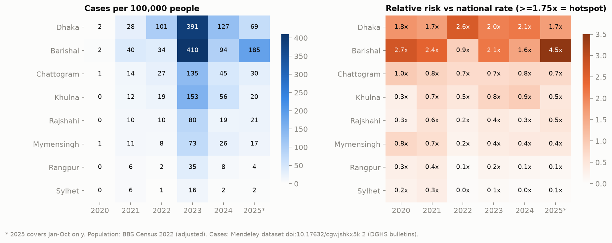
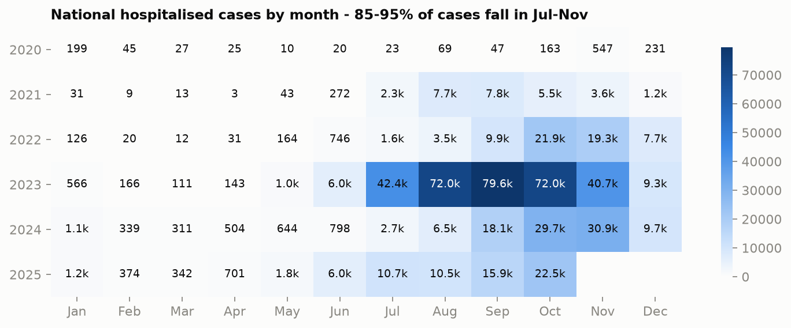
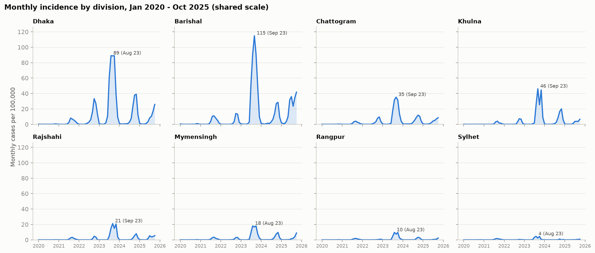
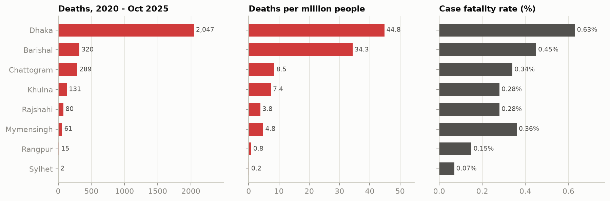
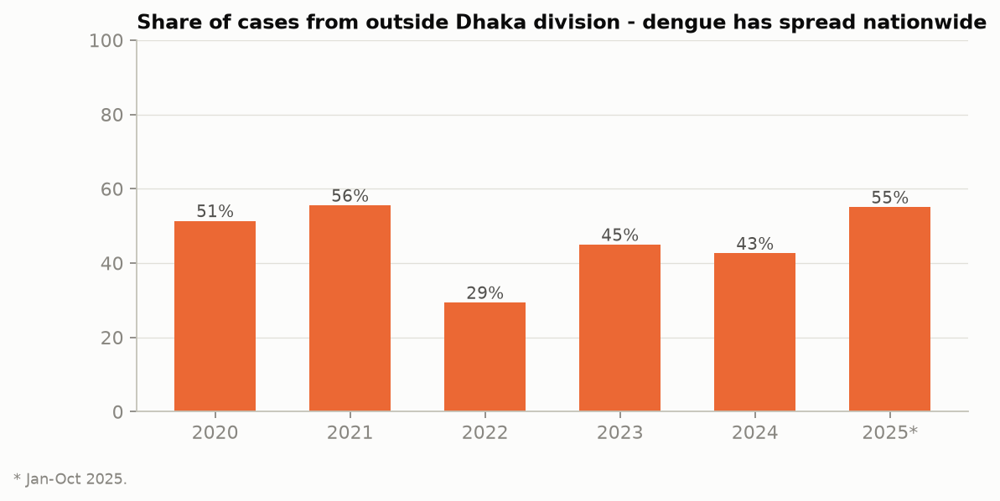
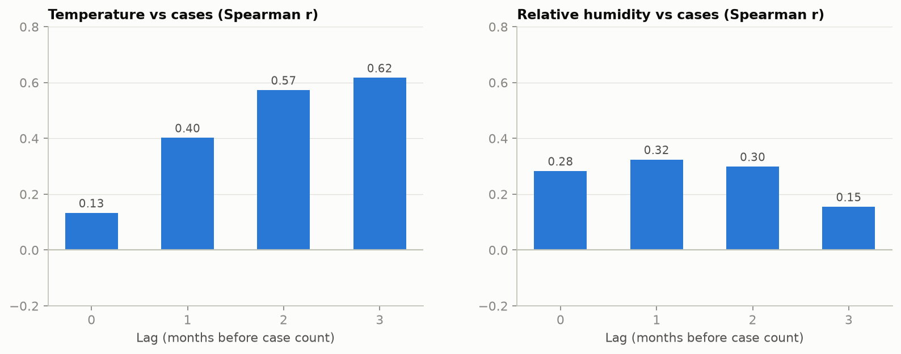
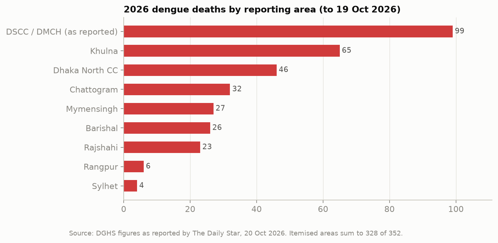

# dengue-analysis

How dengue has hit Bangladesh from 2000 to October 2026: where the hotspots are and how they have moved over time, how large the burden is, how many people die, and how cases relate to the seasons and climate.

## Key findings

1. **Dengue has gone from an occasional outbreak to a yearly epidemic.** From 2000 to 2018 Bangladesh recorded about **50,000** hospitalised cases in total. From 2019 to 21 Oct 2026 it recorded **835,000**, with **3,629 deaths**. 2023 was the worst year on record, with **321,179 cases and 1,705 deaths**. Every year since 2023 has passed 100,000 cases, and **2026 already stands at 116,990 cases** (21 Oct), more than all of 2024 or 2025.
2. **Barishal and Dhaka are the persistent hotspots.** When cases are adjusted for population, **Barishal has the highest burden in the country**, at 131 cases per 100k people per year over 2020–2025. Dhaka is close behind at 123. Both are above 1.75× the national rate in most years. In 2025 Barishal reached **4.5× the national rate**. Chattogram and Khulna are second-tier areas. Sylhet and Rangpur have stayed low throughout (under 0.4× the national rate).
3. **The disease has spread out of Dhaka.** In 2022, 29% of cases came from outside Dhaka division. By 2025 that share had risen to **55%**. In 2026, Khulna has the second-highest death toll (65 deaths), behind only the Dhaka city area.
4. **Deaths are concentrated in Dhaka.** Dhaka division accounts for 55% of cases but **70% of deaths**, with a case fatality rate (CFR) of **0.63%**, compared with 0.07–0.45% in other divisions. A large part of this is probably because severely ill patients are referred to Dhaka hospitals and their deaths are recorded there. Reports from 2026 also point to late hospitalisation and dengue shock as the main drivers of deaths.
5. **The case fatality rate has gone up and then come down.** It rose from 0.18% in 2019 to 0.53% in 2023 and **0.57% in 2024**. It fell to 0.40% in 2025 and 0.31% in 2026 so far.
6. **The season is predictable.** Between 85% and 95% of each year's cases occur from **July to November**, with the peak in September, October or November. In 2025 the season started early, with 6,000 cases already in June.
7. **Climate is linked to cases with a delay.** Monthly cases correlate most strongly with temperature **2–3 months earlier** (Spearman r ≈ 0.6). The link with humidity is weaker (r ≈ 0.3 at a 1-month lag). These correlations are descriptive only, because the yearly seasonal cycle affects both temperature and cases.

## Charts

| | |
|---|---|
|  |  |
|  |  |
|  |  |
|  |  |

### Hotspot table (relative risk vs national incidence)

A division is classed as a **hotspot** at ≥1.75×, **elevated** at 1.25–1.75×, **average** at 0.75–1.25× and **low** below 0.75×.

| Division | 2020 | 2021 | 2022 | 2023 | 2024 | 2025* |
|---|---|---|---|---|---|---|
| Dhaka | hotspot 1.8× | elevated 1.7× | hotspot 2.6× | hotspot 2.0× | hotspot 2.1× | elevated 1.7× |
| Barishal | hotspot 2.7× | hotspot 2.4× | average 0.9× | hotspot 2.1× | elevated 1.6× | **hotspot 4.5×** |
| Chattogram | average 1.0× | average 0.8× | low 0.7× | low 0.7× | average 0.8× | low 0.7× |
| Khulna | low 0.3× | low 0.7× | low 0.5× | average 0.8× | average 0.9× | low 0.5× |
| Rajshahi | low | low | low | low | low | low |
| Mymensingh | average 0.8× | low | low | low | low | low |
| Rangpur | low | low | low | low | low | low |
| Sylhet | low | low | low | low | low | low |

\* 2025 covers January–October only.

## Data sources

| File | What it contains | Source |
|---|---|---|
| `data/raw/mendeley/dataset.xlsx` | Monthly cases, deaths, temperature, humidity and pressure for each of the 8 divisions, Jan 2020 – Oct 2025 | Mendeley Data, [doi:10.17632/cgwjshkx5k.2](https://data.mendeley.com/datasets/cgwjshkx5k), compiled from DGHS bulletins |
| `data/external/national_yearly_2000_2026.csv` | National cases and deaths for each year | 2000–2022: Hossain et al. 2023, [PMC10334535](https://pmc.ncbi.nlm.nih.gov/articles/PMC10334535/), Table 1. 2023–2026: DGHS figures reported by [Dhaka Tribune](https://www.dhakatribune.com/bangladesh/health/420184/dengue-two-more-die-as-1-232-cases-recorded-in-24) and [TBS](https://www.tbsnews.net/bangladesh/health/dengue-death-toll-reaches-364-7-more-die-1579376) |
| `data/external/division_population_2022.csv` | Population of each division | BBS Population & Housing Census 2022 (adjusted figures) |
| `data/external/snapshot_2026_division.csv` | 2026 year-to-date cases and deaths by area | [The Daily Star, 20 Oct 2026](https://www.thedailystar.net/news/healthcare/disease/news/dengue-deaths-mount-amid-treatment-delays-4303091) and [MesVaccins](https://www.mesvaccins.net/web/news/24502), both citing the DGHS dashboard |

## Reproduce

```bash
python3 -m venv .venv && .venv/bin/pip install -r requirements.txt
.venv/bin/python src/clean.py      # creates data/processed/monthly_division_2020_2025.csv
.venv/bin/python src/analysis.py   # creates the tables in reports/ and the charts in figures/
```

The tables written to `reports/` are:

- `division_year_burden.csv`: incidence, deaths per million, CFR, relative risk, hotspot tier and rank for each division and year
- `division_overall_2020_2025.csv`: totals for each division, including its share of cases and deaths and the number of months with incidence of 10 or more per 100k
- `seasonal_peaks.csv`: the peak month in each year and the share of cases that fall in July–November
- `climate_lag_correlations.csv`: correlations between cases and temperature or humidity at lags of 0–3 months
- `national_yearly_with_cfr.csv`: national cases and deaths per year with the case fatality rate

## Caveats

- **Cases are hospitalised cases** reported to DGHS. Outpatient and unreported infections are not included, so the true number of infections is much higher.
- **Deaths are recorded where the patient dies.** Referral to Dhaka hospitals therefore inflates Dhaka's death count and lowers the counts in the divisions patients came from.
- **Only division-level data is available.** The source does not split Dhaka division into Dhaka city (DNCC/DSCC) and the rest of the division, and no open district-level time series was found. The DGHS dashboard could not be accessed from outside Bangladesh.
- **The monthly data has gaps and at least one likely error.** It ends in October 2025. Dhaka's August and October 2023 counts are both exactly 40,615, which is probably a copy error in the source. Even so, the dataset's yearly totals agree with the official DGHS totals to within 1%.
- **Some figures come from news reports.** Figures from 2023 onward are DGHS numbers taken from news coverage, and sources differ slightly from each other (for example, 2025 is given as 102,562 or 102,861 cases).
- **Population figures are fixed at 2022.** Census 2022 populations are used for every year, so incidence in earlier and later years is approximate.
