# Dengue in Bangladesh: hot zones, burden and deaths (2000–2026)

An open, reproducible analysis of where dengue strikes Bangladesh, how the hot zones shift from year to year, and who dies. It combines official DGHS surveillance data, district-level case counts, census populations and map boundaries in a single Jupyter notebook.

**→ Read the full analysis: [`notebooks/dengue_analysis.ipynb`](notebooks/dengue_analysis.ipynb)** (GitHub shows it with all charts, maps and tables already rendered).

---

## Summary

Dengue in Bangladesh has changed from an occasional outbreak into an epidemic that returns every year. **By case count, 2026 is already the second-worst year on record, behind only 2023.** By 21 October it had passed the full-year totals for 2019, 2024 and 2025. Cases are spreading out of Dhaka: **Barishal** has the most cases per person, **Khulna** is the fastest-growing hot zone in 2026, and a fixed group of southern and central districts appears near the top every year.

## At a glance

| Year | Hospitalised cases | Deaths | Case fatality rate |
|---|---:|---:|---:|
| 2019 | 101,354 | 179 | 0.18% |
| 2023 (record) | **321,179** | **1,705** | 0.53% |
| 2024 | 101,214 | 575 | 0.57% |
| 2025 | 102,861 | 413 | 0.40% |
| 2026 (to 21 Oct) | **116,990** | 364 | 0.31% |

For comparison, all of 2000–2018 added together came to about 50,000 cases.

## Where: 2025 vs 2026

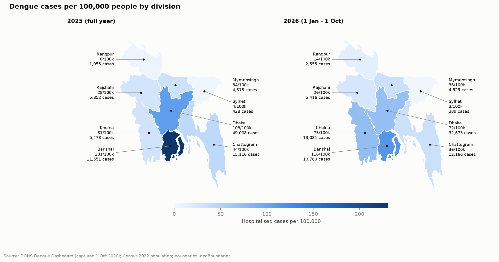

| Division | 2025 cases | 2025 per 100k | 2026 cases* | 2026 per 100k* | Status in 2026 |
|---|---:|---:|---:|---:|---|
| Barishal | 21,551 | **231** | 10,789 | **116** | 🔴 hotspot (2.4× national) |
| Dhaka | 49,068 | 108 | 32,673 | 72 | 🟠 elevated (1.5×) |
| Khulna | 5,473 | 31 | 13,081 | 73 | 🟠 elevated (1.5×), up from low |
| Chattogram | 15,116 | 44 | 12,166 | 36 | low |
| Mymensingh | 4,318 | 34 | 4,529 | 36 | low |
| Rajshahi | 5,852 | 28 | 5,416 | 26 | low |
| Rangpur | 1,055 | 6 | 2,555 | 14 | low |
| Sylhet | 428 | 4 | 389 | 3 | low |

\* 2026 division figures run from 1 Jan to 1 Oct (DGHS dashboard). Status is based on relative risk; see [Methods](#methods).

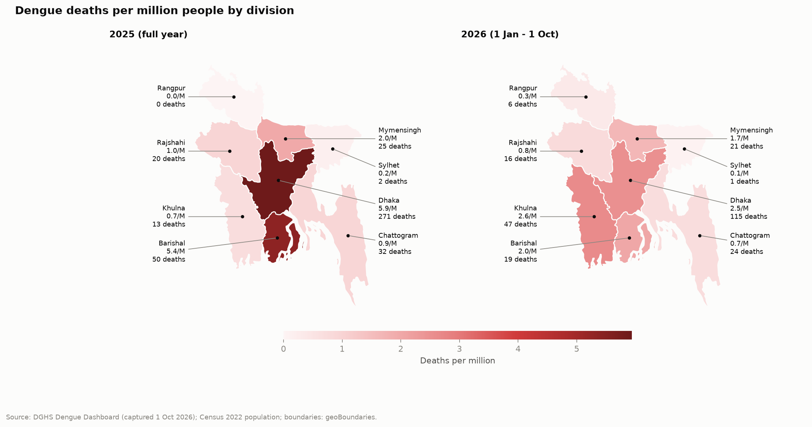

## Key findings

1. **2026 has about twice as many cases as 2025 at the same point in the year.** Weeks 1–39 had 81,589 cases, compared with 41,089 in the same weeks of 2025. September 2026, with 43,774 cases, was the busiest month since 2023.
2. **Barishal has the highest burden for its population.** It had 231 cases per 100,000 people in 2025, 3.8× the national rate, and it was a hotspot in 5 of the last 7 years (1.6× in 2024).
3. **Khulna is the emerging hot zone.** Its cases have more than doubled, and it now has the **highest dengue death rate in the country** at 2.6 per million people (47 deaths).
4. **The same districts are hot zones every year.** Dhaka, Barisal, Pirojpur, Barguna, Madaripur and Narail were in the national top 10 for cases per person in **every year** with usable district data. Manikganj and Cox's Bazar were in it in 6 of those 7 years.
5. **Most deaths happen in Dhaka city, but that share is falling.** The two Dhaka city corporations had 31% of 2025 cases but **63% of deaths**, partly because the sickest patients are referred to Dhaka hospitals. In 2026 the city's share of deaths has dropped to 40%.
6. **Women die at about twice the rate of men once hospitalised.** This holds every year (0.76% vs 0.39% in 2023, and 0.42% vs 0.23% in 2026), even though about 60% of patients are men.
7. **Risk rises with age.** Most patients are aged 16–35, but the case fatality rate goes above 1% after age 60.
8. **The season is predictable.** Between 82% and 95% of each year's cases come in **July–November**. Cases rise and fall with temperature 2–3 months earlier.

## More charts

**Persistent hot zones, district level**

| District incidence, 2022 and 2023 | Districts that keep coming back |
|---|---|
| 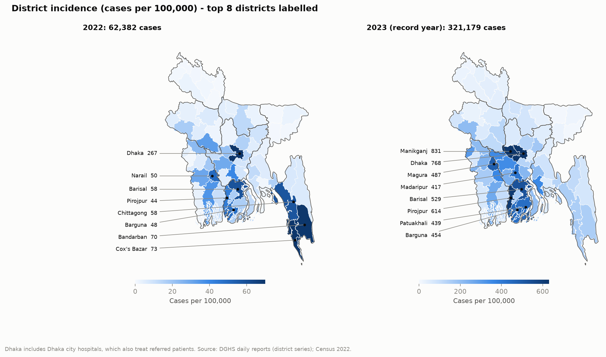 | 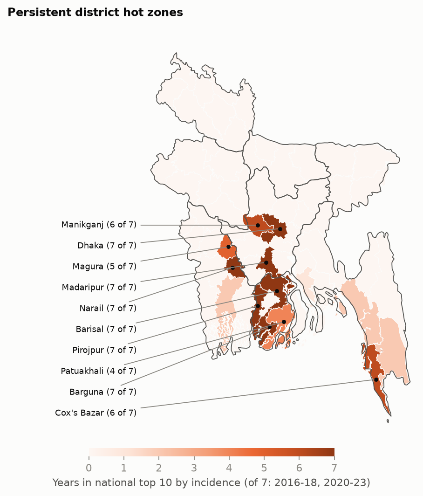 |

**Hot zones over time and the 2026 season**

| Relative risk by division, 2020–2026 | 2026 vs 2025, week by week |
|---|---|
| 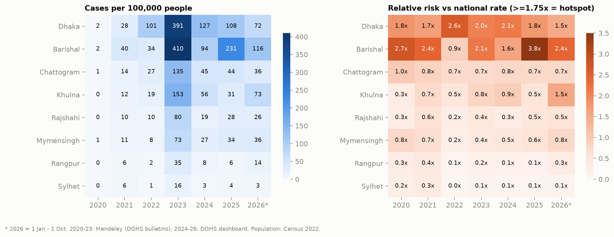 | 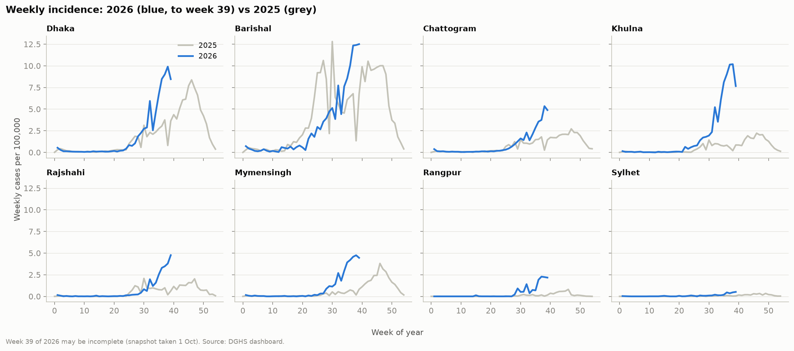 |

**Long-term trend and seasonality**

| Cases, deaths and fatality rate, 2000–2026 | Cases by month |
|---|---|
| 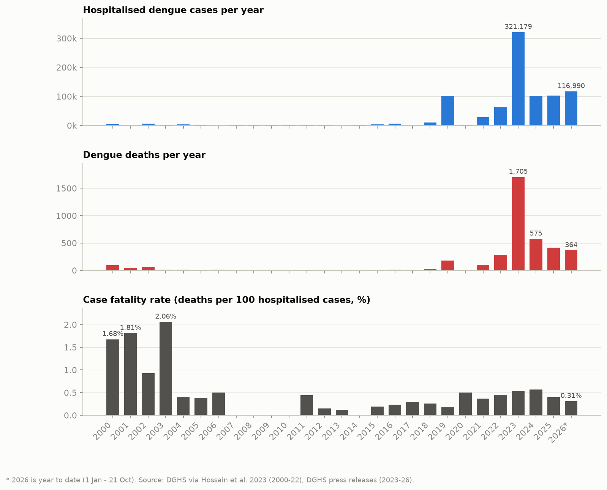 | 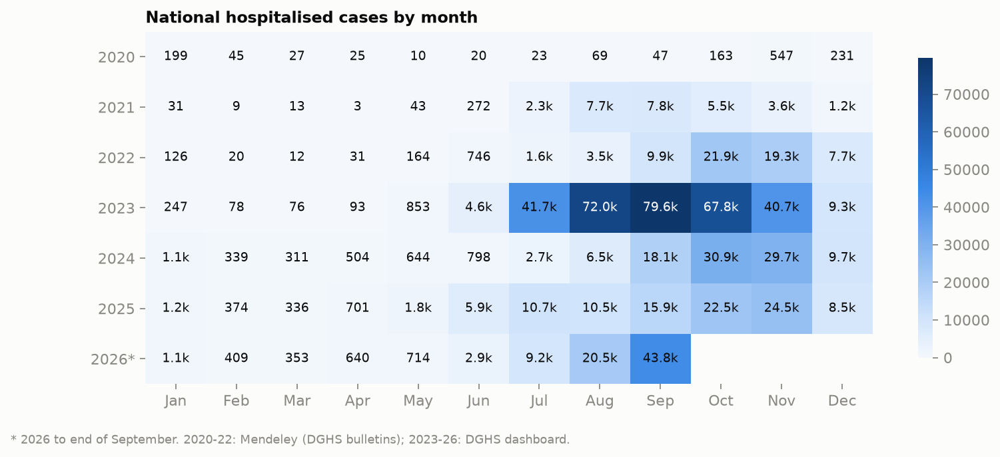 |

**Who dies, and where**

| Dhaka city vs the rest | Death rate and fatality rate by division |
|---|---|
| 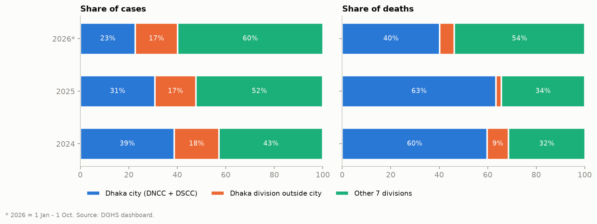 | 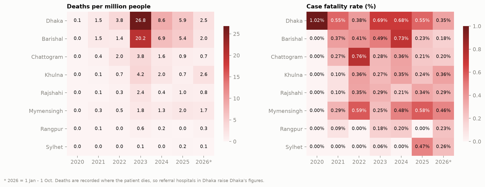 |

| Age and sex | Climate lag |
|---|---|
| 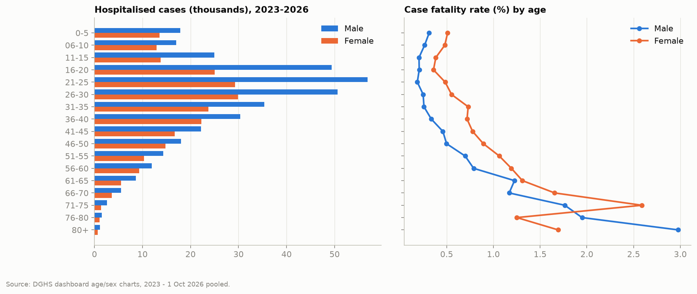 | 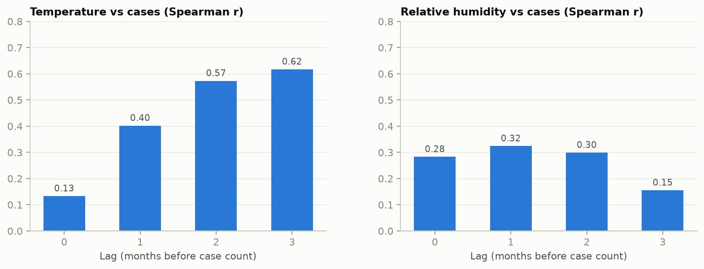 |

## Methods

| Term | Definition |
|---|---|
| **Cases** | Hospitalised dengue cases reported to DGHS |
| **Incidence** | Cases ÷ 2022 census population × 100,000 |
| **Relative risk** | A division's incidence ÷ the national incidence for the same year |
| **Hotspot tiers** | ≥1.75× = hotspot · 1.25–1.75× = elevated · 0.75–1.25× = average · <0.75× = low |
| **Case fatality rate (CFR)** | Deaths ÷ hospitalised cases |
| **Persistent hot zone** | Number of years (out of 2016–18 and 2020–23) a district was in the national top 10 by incidence |
| **Climate lag** | Spearman correlation between a division's monthly cases and its temperature or humidity 0–3 months earlier |

## Data sources

| Dataset | Coverage | Source |
|---|---|---|
| DGHS Dengue Dashboard: division and city-corporation totals, weekly and monthly series, age and sex | 2023 – 1 Oct 2026 | [dashboard.dghs.gov.bd](https://dashboard.dghs.gov.bd/pages/heoc_dengue_v1.php), snapshot captured by [Ashiq-r-khan/Bangladesh-Dengue-Forecasting-Analysis](https://github.com/Ashiq-r-khan/Bangladesh-Dengue-Forecasting-Analysis) |
| National yearly cases and deaths | 2000 – 21 Oct 2026 | [Hossain et al. 2023](https://pmc.ncbi.nlm.nih.gov/articles/PMC10334535/) (2000–22); DGHS figures via [Dhaka Tribune](https://www.dhakatribune.com/bangladesh/health/420184/dengue-two-more-die-as-1-232-cases-recorded-in-24), [Xinhua](https://english.news.cn/20251228/e1aeeae58a6047e88e4f45e5e13cf4c8/c.html), [TBS](https://www.tbsnews.net/bangladesh/health/dengue-death-toll-reaches-364-7-more-die-1579376) |
| Monthly cases, deaths and climate by division | Jan 2020 – Oct 2025 | [Mendeley Data, doi:10.17632/cgwjshkx5k.2](https://data.mendeley.com/datasets/cgwjshkx5k) |
| Monthly cases for all 64 districts | 2016 – Feb 2024 | DGHS daily reports, compiled by [Khalidsyfullah/Research-on-Bangladeshi-Dengue-Data](https://github.com/Khalidsyfullah/Research-on-Bangladeshi-Dengue-Data) |
| Population by division and district | Census 2022 | Bangladesh Bureau of Statistics |
| Division and district boundaries | — | [geoBoundaries](https://www.geoboundaries.org): ADM1 (CC0), ADM2 (CC BY 3.0 IGO) |

## Limitations

- **Only hospitalised, reported cases are counted.** Infections that were never reported or treated in hospital are missing, so the true number of infections is higher.
- **Deaths are recorded where the patient dies.** Severe cases are referred to Dhaka hospitals, which pushes Dhaka's death figures up and the other divisions' figures down.
- **The 2026 figures have two cut-off dates.** Division figures run to 1 Oct 2026, the date of the dashboard snapshot. National totals run to 21 Oct 2026.
- **District data is older and incomplete.** It ends in early 2024, and 2019 covers only about a quarter of that year's cases, so 2019 is excluded. Dhaka district also includes patients referred to Dhaka city hospitals from other districts.
- **There are small errors in the source data.** One duplicated monthly value in the Mendeley dataset is flagged in the notebook. Age labels that a spreadsheet had turned into dates (for example "06-Oct" for ages 6–10) were repaired.
- **Population is fixed at 2022 census figures**, so rates for other years are approximate.

## Reproduce

```bash
git clone https://github.com/MehrazRumman/dengue-analysis.git
cd dengue-analysis
python3 -m venv .venv && .venv/bin/pip install -r requirements.txt
.venv/bin/jupyter lab notebooks/dengue_analysis.ipynb   # then Run All
```

Running the notebook rebuilds everything in `data/processed/`, `reports/` and `figures/`.

```
notebooks/dengue_analysis.ipynb   the analysis
data/raw/                         downloaded source files, unchanged
data/external/                    small hand-built tables (national series, populations) with sources
data/processed/                   cleaned tables (generated)
reports/                          result tables as CSV (generated)
figures/                          charts and maps (generated)
```
